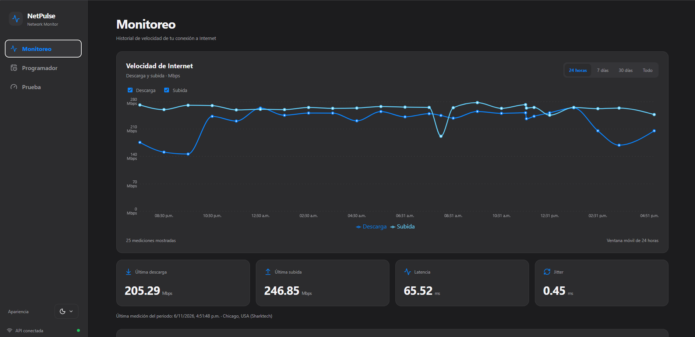
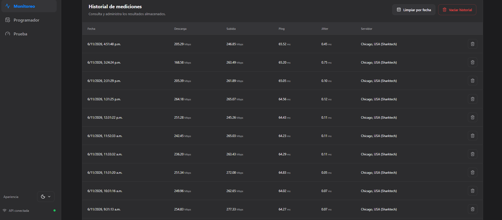
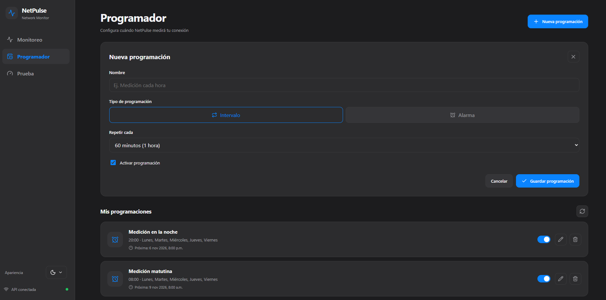
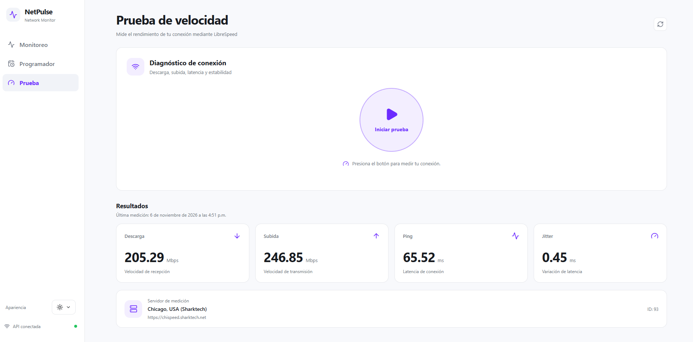

# NetPulse

**Language:** [Español](README.md) | **English**

**NetPulse** is an open-source application for monitoring Internet connection speeds through a web dashboard.

It allows users to run manual speed tests, schedule automatic measurements, visualize statistics, and browse historical results stored in SQLite.

It is designed to run on Linux servers, home computers, mini PCs, and laboratory environments using Docker Compose.

> **Current version:** v0.1.0  
> **Status:** Functional release intended for trusted private networks.

## Screenshots

### Main dashboard



### Measurement history



### Automatic scheduling



### Manual speed test



## Features

### Speed measurements

- Manual speed tests using LibreSpeed CLI.
- Download and upload speed measurements.
- Ping and jitter measurements.
- Identification of the server used for each test.
- Persistent storage of measurement results.

### Automatic scheduling

- Automatic tests at configurable intervals.
- Scheduling on specific days and at specific times.
- Managing schedules through the dashboard.
- Viewing scheduled test executions.

### Visualization

- Web dashboard built with React and TypeScript.
- Interactive charts using Recharts.
- Filters for the last 24 hours, 7 days, 30 days, and all available chart data.
- Result updates through Server-Sent Events (SSE).
- Responsive layout for different screen sizes.
- Light and dark themes.

### Measurement history

- SQLite storage.
- Measurements ordered from newest to oldest.
- Server-side pagination.
- 10 records per page.
- Navigation through the entire measurement history.
- Deletion of individual measurements.
- Deletion of measurements older than a specified date.
- Deletion of the entire history with confirmation.

**Note:** The history table uses SQLite-backed pagination, while the chart currently retrieves up to the 500 most recent measurements.

## Technologies

| Component | Technology |
|---|---|
| Frontend | React, TypeScript, and Vite |
| Charts | Recharts |
| Backend | Node.js and Fastify |
| Speed testing | LibreSpeed CLI |
| Database | SQLite |
| Real-time updates | Server-Sent Events |
| Web server | Nginx |
| Containers | Docker and Docker Compose |

## Requirements

To run NetPulse with Docker:

- An operating system compatible with Docker.
- Docker Engine.
- Docker Compose.
- Internet connectivity.
- An available TCP port 8086.

Node.js does not need to be installed directly on the host when using Docker.

## Installation with Docker Compose

Clone the repository:

```bash
git clone https://github.com/Borjaeditions/netpulse.git
cd netpulse
```

Build and start the containers:

```bash
docker compose up -d --build
```

Open the dashboard in your browser:

```text
http://SERVER_IP:8086
```

If you are accessing NetPulse from the host machine:

```text
http://localhost:8086
```

### Verify the installation

Check the containers:

```bash
docker compose ps
```

View the logs:

```bash
docker compose logs -f
```

Check the API:

```bash
curl http://localhost:8086/api/health
```

## Container management

### Update NetPulse

```bash
git pull --ff-only
docker compose up -d --build
```

Alternatively, use the included shell script:

```bash
./actualizar.sh
```

### Restart

```bash
docker compose restart
```

### Stop

```bash
docker compose down
```

### View API logs

```bash
docker compose logs --tail=100 api
```

### View web server logs

```bash
docker compose logs --tail=100 web
```

## Port configuration

By default, NetPulse uses port 8086.

In `compose.yaml`:

```yaml
ports:
  - "8086:80"
```

To use a different port, change the first number.

For example:

```yaml
ports:
  - "8090:80"
```

Then apply the change:

```bash
docker compose up -d
```

## Data persistence

NetPulse uses SQLite to store speed measurements and scheduling information.

The database is located at:

```text
./data/netpulse.db
```

Docker mounts this directory inside the API container:

```yaml
volumes:
  - ./data:/app/data
```

This preserves data when the containers are rebuilt.

**Important:** Do not delete the `data/` directory if you want to keep your measurement history.

To back up the database by copying its files, temporarily stop the services before copying the `data/` directory. Alternatively, use a backup method compatible with SQLite in WAL mode.

## API

NetPulse provides HTTP endpoints for retrieving measurements, running tests, and managing measurement history.

### Retrieve recent measurements

```http
GET /api/speedtests?limit=50
```

This endpoint supports a maximum of 500 records.

### Retrieve the latest measurement

```http
GET /api/speedtests/latest
```

### Retrieve paginated measurement history

```http
GET /api/speedtests/page?page=1&pageSize=10
```

The response includes the measurements and pagination metadata:

```json
{
  "results": [],
  "pagination": {
    "page": 1,
    "pageSize": 10,
    "total": 51,
    "totalPages": 6,
    "hasNextPage": true,
    "hasPreviousPage": false
  }
}
```

The values above are illustrative.

### Run a speed test

```http
POST /api/speedtest
```

### Delete a measurement

```http
DELETE /api/speedtests/:id
```

### Delete measurements before a specified date

```http
DELETE /api/speedtests?before=ISO_8601_DATE
```

### Delete the entire measurement history

```http
DELETE /api/speedtests/all
```

This operation requires the following header:

```http
X-Confirm-Delete: DELETE_ALL
```

Deletion operations are also available through the web dashboard.

## Local development

To develop NetPulse without Docker, the following are required:

- Node.js 24 or later.
- npm.

Install dependencies:

```bash
npm ci
```

Build the API:

```bash
npm run build:api
```

Build the frontend:

```bash
npm run build:web
```

To run NetPulse in development mode, open two terminals.

Terminal 1:

```bash
npm run dev:api
```

Terminal 2:

```bash
npm run dev:web
```

If the API runs on another machine, review the Vite proxy configuration.

## Security

**NetPulse v0.1.0 is designed for trusted private networks. It should not be exposed directly to the Internet without additional access controls.**

Currently:

- User authentication is not implemented.
- API routes can run speed tests and modify schedules.
- Deletion routes can remove stored records.
- The confirmation header for deleting the entire history is not an authentication mechanism.
- Nginx acts as a reverse proxy but does not, by itself, restrict who can access the API.

We recommend running NetPulse behind a firewall and limiting access to authorized devices.

To restrict access to the host machine only, publish the port as follows:

```yaml
ports:
  - "127.0.0.1:8086:80"
```

Shared or public deployments will require additional authentication and authorization controls.

## Roadmap

### Implemented features

- [x] Manual speed tests.
- [x] Automatic test scheduling.
- [x] Persistent SQLite storage.
- [x] Interactive charts.
- [x] Time-range filters.
- [x] SSE updates.
- [x] Responsive interface.
- [x] Light and dark themes.
- [x] Docker Compose deployment.
- [x] Deletion of individual records.
- [x] Deletion by date.
- [x] Deletion of the entire history.
- [x] Server-side pagination.

### Future improvements

- [ ] Export measurement history to CSV.
- [ ] Alerts for degraded connection speeds or latency.

## License

NetPulse is distributed under the MIT License.

See the [LICENSE](LICENSE) file for the full license terms.

---

Developed by [Borjaeditions](https://github.com/Borjaeditions).
