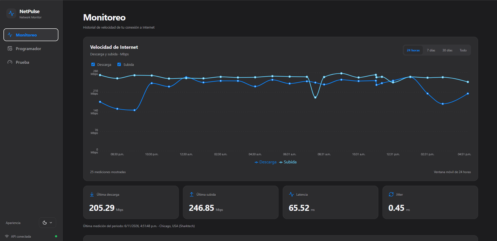
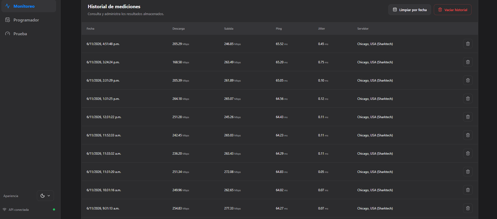
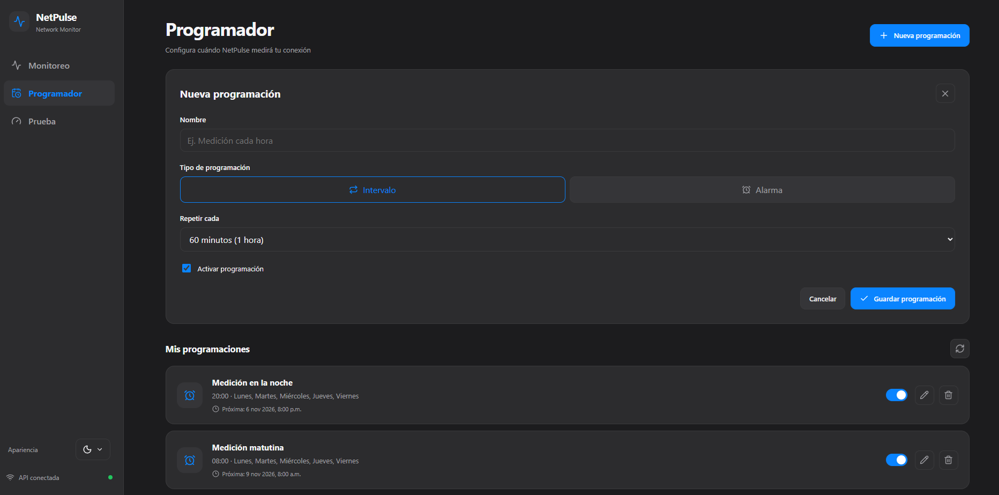
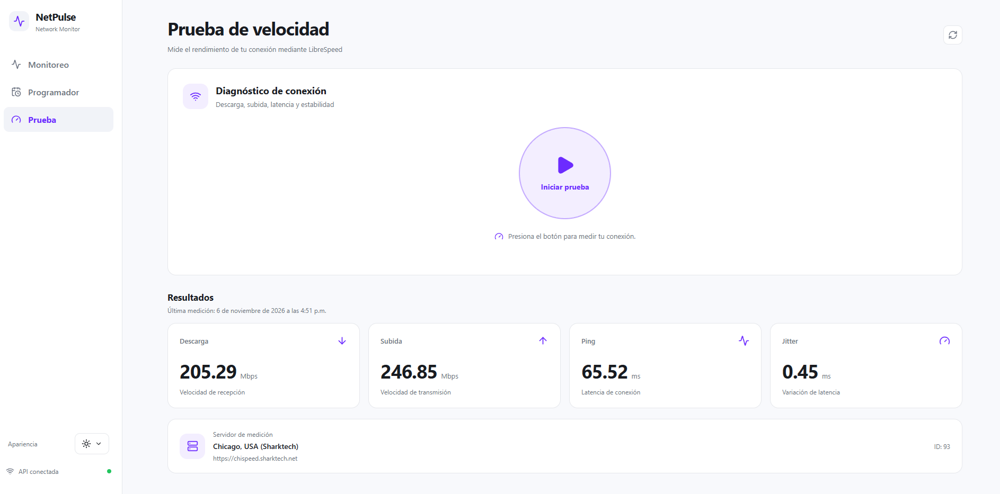

# NetPulse

**NetPulse** es una aplicación de código abierto para monitorear la velocidad de conexión a Internet desde un panel web.

Permite realizar pruebas manuales, programar mediciones automáticas, visualizar estadísticas y consultar el historial de resultados almacenados en SQLite.

Está diseñado para ejecutarse en servidores Linux, equipos domésticos, mini PC y entornos de laboratorio mediante Docker Compose.

> **Versión actual:** v0.1.0  
> **Estado:** versión funcional orientada a redes privadas de confianza.

## Capturas de pantalla

### Panel principal



### Historial de mediciones



### Programación automática



### Prueba manual de velocidad



## Características

### Mediciones de velocidad

- Pruebas manuales de velocidad mediante LibreSpeed CLI.
- Medición de velocidad de descarga y subida.
- Medición de ping y jitter.
- Identificación del servidor utilizado para cada prueba.
- Almacenamiento persistente de los resultados.

### Programación automática

- Ejecución automática de pruebas por intervalos.
- Programación por días y horarios específicos.
- Administración de las programaciones desde el panel.
- Consulta de ejecuciones programadas.

### Visualización

- Panel web desarrollado con React y TypeScript.
- Gráficas interactivas con Recharts.
- Filtros de 24 horas, 7 días, 30 días y todo el periodo disponible.
- Actualización de resultados mediante Server-Sent Events (SSE).
- Diseño adaptable a diferentes tamaños de pantalla.
- Temas claro y oscuro.

### Historial de mediciones

- Almacenamiento mediante SQLite.
- Ordenamiento de mediciones desde la más reciente.
- Paginación del lado del servidor.
- Consulta de 10 registros por página.
- Navegación por todo el historial.
- Eliminación individual de mediciones.
- Eliminación de mediciones anteriores a una fecha.
- Eliminación completa del historial mediante confirmación.

**Nota:** la tabla utiliza paginación desde SQLite, mientras que la gráfica consulta actualmente hasta 500 mediciones recientes.

## Tecnologías

| Componente | Tecnología |
|---|---|
| Frontend | React, TypeScript y Vite |
| Gráficas | Recharts |
| Backend | Node.js y Fastify |
| Pruebas de velocidad | LibreSpeed CLI |
| Base de datos | SQLite |
| Comunicación en tiempo real | Server-Sent Events |
| Servidor web | Nginx |
| Contenedores | Docker y Docker Compose |

## Requisitos

Para ejecutar NetPulse mediante Docker:

- Sistema operativo compatible con Docker.
- Docker Engine.
- Docker Compose.
- Conexión a Internet.
- Puerto TCP 8086 disponible.

No es necesario instalar Node.js directamente en el servidor cuando se utiliza Docker.

## Instalación con Docker Compose

Clona el repositorio:

```bash
git clone https://github.com/Borjaeditions/netpulse.git
cd netpulse
```

Construye e inicia los contenedores:

```bash
docker compose up -d --build
```

Abre el panel desde tu navegador:

```text
http://IP_DEL_SERVIDOR:8086
```

Si estás trabajando desde el propio servidor:

```text
http://localhost:8086
```

### Verificar el funcionamiento

Consultar los contenedores:

```bash
docker compose ps
```

Consultar los registros:

```bash
docker compose logs -f
```

Comprobar la API:

```bash
curl http://localhost:8086/api/health
```

## Administración de contenedores

### Actualizar NetPulse

```bash
git pull --ff-only
docker compose up -d --build
```
o script en shell
```bash
./actualizar.sh
```

### Reiniciar

```bash
docker compose restart
```

### Detener

```bash
docker compose down
```

### Consultar registros de la API

```bash
docker compose logs --tail=100 api
```

### Consultar registros del servidor web

```bash
docker compose logs --tail=100 web
```

## Configuración del puerto

De manera predeterminada, NetPulse utiliza el puerto 8086.

En `compose.yaml`:

```yaml
ports:
  - "8086:80"
```

Para utilizar otro puerto, modifica el primer número.

Por ejemplo:

```yaml
ports:
  - "8090:80"
```

Después aplica el cambio:

```bash
docker compose up -d
```

## Persistencia de datos

NetPulse utiliza SQLite para almacenar las mediciones y la información de programación.

La base de datos se encuentra en:

```text
./data/netpulse.db
```

Docker monta este directorio dentro del contenedor de la API:

```yaml
volumes:
  - ./data:/app/data
```

Esto permite conservar los datos aunque se reconstruyan los contenedores.

**Importante:** no elimines el directorio `data/` si deseas conservar el historial.

Para realizar un respaldo mediante copia de archivos, detén temporalmente los servicios antes de copiar el directorio `data/`. También puedes utilizar mecanismos de respaldo compatibles con SQLite en modo WAL.

## API

NetPulse dispone de endpoints HTTP para consultar mediciones, ejecutar pruebas y administrar el historial.

### Consultar mediciones recientes

```http
GET /api/speedtests?limit=50
```

El límite máximo de este endpoint es de 500 registros.

### Consultar la última medición

```http
GET /api/speedtests/latest
```

### Consultar historial paginado

```http
GET /api/speedtests/page?page=1&pageSize=10
```

La respuesta incluye los resultados y los metadatos de paginación:

```json
{
  "results": [],
  "pagination": {
    "page": 1,
    "pageSize": 10,
    "total": 51,
    "totalPages": 6,
    "hasNextPage": true,
    "hasPreviousPage": false
  }
}
```

Los valores anteriores son ilustrativos.

### Ejecutar una medición

```http
POST /api/speedtest
```

### Eliminar una medición

```http
DELETE /api/speedtests/:id
```

### Eliminar mediciones anteriores a una fecha

```http
DELETE /api/speedtests?before=FECHA_ISO_8601
```

### Eliminar todo el historial

```http
DELETE /api/speedtests/all
```

Esta operación requiere el encabezado:

```http
X-Confirm-Delete: DELETE_ALL
```

Las operaciones de eliminación también están disponibles desde el panel web.

## Desarrollo local

Para desarrollar NetPulse sin Docker se requiere:

- Node.js 24 o superior.
- npm.

Instala las dependencias:

```bash
npm ci
```

Compila la API:

```bash
npm run build:api
```

Compila el frontend:

```bash
npm run build:web
```

Para ejecutar en modo desarrollo, utiliza dos terminales.

Terminal 1:

```bash
npm run dev:api
```

Terminal 2:

```bash
npm run dev:web
```

Si la API está alojada en otro equipo, revisa la configuración del proxy de Vite.

## Seguridad

**NetPulse v0.1.0 está diseñado para redes privadas de confianza. No debe exponerse directamente a Internet sin controles de acceso adicionales.**

Actualmente:

- No dispone de autenticación de usuarios.
- Las rutas de la API pueden ejecutar mediciones y modificar programaciones.
- Las rutas de eliminación permiten borrar registros.
- El encabezado de confirmación para vaciar el historial no constituye un mecanismo de autenticación.
- Nginx actúa como proxy inverso, pero no restringe por sí mismo quién puede utilizar la API.

Se recomienda utilizar NetPulse detrás de un firewall y limitar el acceso a dispositivos autorizados.

Para restringir el acceso únicamente al equipo anfitrión, puedes publicar el puerto de esta manera:

```yaml
ports:
  - "127.0.0.1:8086:80"
```

Para instalaciones compartidas o públicas será necesario implementar autenticación y controles de autorización.

## Hoja de ruta

### Funcionalidades implementadas

- [x] Pruebas manuales de velocidad.
- [x] Programación automática de mediciones.
- [x] Almacenamiento persistente en SQLite.
- [x] Gráficas interactivas.
- [x] Filtros por periodo.
- [x] Actualización mediante SSE.
- [x] Interfaz adaptable.
- [x] Temas claro y oscuro.
- [x] Despliegue mediante Docker Compose.
- [x] Eliminación individual de registros.
- [x] Eliminación por fecha.
- [x] Eliminación completa del historial.
- [x] Paginación del lado del servidor.

### Mejoras futuras

- [ ] Autenticación de usuarios.
- [ ] Exportación del historial a CSV.
- [ ] Alertas por degradación de velocidad o latencia.

## Licencia

NetPulse se distribuye bajo la licencia MIT.

Consulta el archivo [LICENSE](LICENSE) para conocer sus términos.

---

Desarrollado por [Borjaeditions](https://github.com/Borjaeditions).
